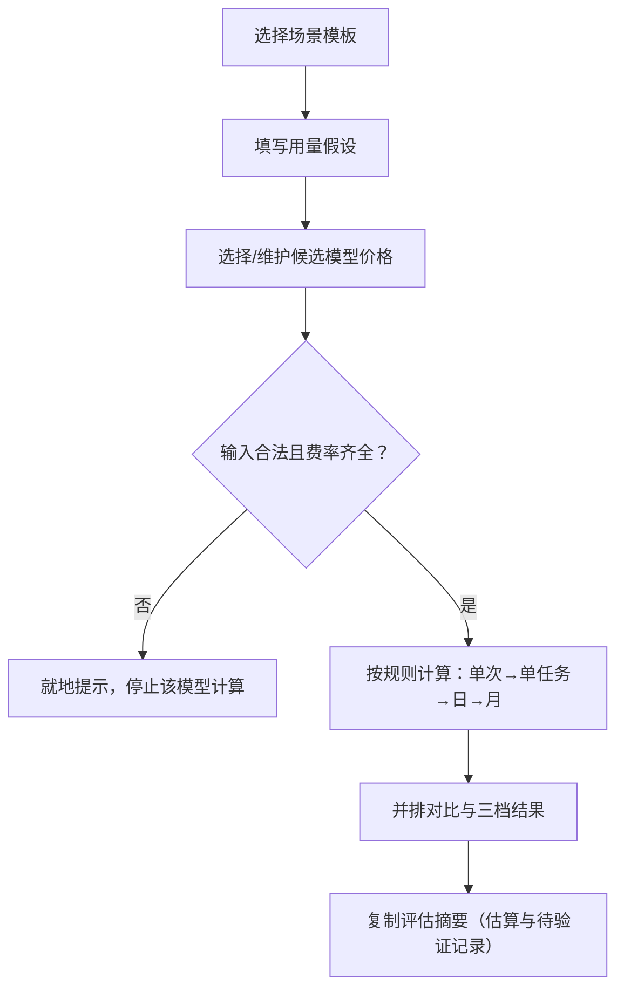

# Product Requirement｜AI 模型选型与成本估算工具


## 1. 产品场景摘要

| 项目 | 内容 |
|---|---|
| 产品定位 | 单页网页工具，在项目上线前比较不同模型的**文本 API 推理成本**。是成本估算工具，不是聊天机器人，也不替用户决定“最佳模型” |
| 目标用户 | 产品经理、开发者、AI 负责人 |
| 使用时机 | 选型评估阶段，需要把“用量假设 × 模型单价”变成可对比、可复核的月度成本 |
| 输入 | 场景、请求量（日或月）、运行天数、每任务调用次数、单次输入/输出 tokens、候选模型及单价、可选缓存占比与预算 |
| 输出 | 并排成本对比、三档（低/基准/高）假设下的月成本、计算中间值、可复制的评估摘要 |
| 产品性质 | 纯前端本地计算；无登录、不收集个人信息、无需密钥与后端数据库 |
| 待确认信息 | 各模型最新官方费率与核对日期、阶梯价规则覆盖范围、用户实际 token 分布 |

## 2. 设计原则

本案例刻意**不使用 Agent**。成本计算是确定性问题，适合用公式而不是模型判断。

| 原则 | 具体要求 |
|---|---|
| 确定性计算 | 全部用公式计算，禁止让 LLM 心算；不调用大模型、Agent、Workflow 或任何 API |
| 不替用户决策 | 排序标签只能叫“按当前输入假设的成本排序”；没有质量数据，不得称“最适合”“最佳” |
| 缺数据不猜测 | 查不到的价格留空；模型特征无来源显示“未提供”；规则未实现时停止估算，不静默降级 |
| 假设可见可改 | 默认值标“示例假设，可修改”；三档假设可见可编辑，禁止后台套固定乘数 |
| 边界写明 | 未覆盖的成本进入“估算边界”，不让用户误以为是总成本 |

## 3. 使用流程与模块



| ID | 模块 | 输入 | 规则 | 输出 | 异常处理 |
|---|---|---|---|---|---|
| M1 | 场景区 | 场景模板 / 自定义 | 模板：客服问答与工单回复、知识库问答/RAG、信息抽取与分类、长文档摘要、代码生成、多轮 Agent、自定义；默认值标“示例假设，可修改” | 场景名与默认用量 | 不冒充行业基准 |
| M2 | 用量区 | 每日或每月请求数（二选一）、运行天数、每任务调用次数、单次输入/输出 tokens | 提示以日志或试跑为准；字符数 ≠ token 数 | 用量假设 | 负数、非数字就地提示并停止 |
| M3 | 模型价格区 | 服务商、名称、币种、输入/输出单价（每 1M tokens）；可手动新增或改价 | 只录官方可查费率；显示来源与核对日期；不混用代理费率 | 候选模型价格表 | 缺费率停止该模型；价格过期醒目提示 |
| M4 | 缓存与阶梯价 | 缓存价、缓存占比、阶梯条件 | 见第 5 节 | 分项成本与所用档位 | 规则未实现则停止估算 |
| M5 | 结果区 | M2–M4 的结果 | 单次/单任务/每日/月度/输入/输出/缓存/月 token 量并排；币种不同不排序、不换算，仅提示 | 对比表、预算超限提示 | 无法计算的模型写明原因，不生成金额 |
| M6 | 三档假设 | 低/基准/高三套用量 | 基准默认同步主表单；低/高独立编辑；解除同步须有可见状态且可恢复 | 三档月成本 | 非法输入明确提示 |
| M7 | 评估摘要 | 以上全部 | 见第 6 节 | 可复制文本 | “待填写”的档位不输出月成本 |
| M8 | 说明区 | — | 可展开：估算边界、计算公式、数据来源 | 说明 | — |

页面形态：中文 SaaS 工具页，非聊天框、非营销页；标题 + 副标题 + 场景区 + 用量区 + 模型价格区 + 结果区 + 可展开说明区；可增删模型；适配桌面与手机（窄屏横向滚动，不裁切关键数值）。禁止花哨动画、无意义仪表盘和虚构数据。

## 4. 责任边界

沿用本案例库的分工视角，但这里的执行者不是 Workflow / Agent / Human，而是**公式 / 价格维护者 / 用户**。

| 事项 | 负责方 | 判断理由 | 交接条件 |
|---|---|---|---|
| 成本计算 | 公式（确定性） | 同样输入必须得到同样结果，可手算复核 | 输入非法或费率缺失时停止，交回用户修正 |
| 价格录入与更新 | 人工维护 | 费率会变，且需要官方来源；工具不自动抓取、不猜价 | 价格过期时醒目提示，由维护者重新核对 |
| 用量假设（请求量、tokens、三档） | 用户 | 只有用户知道自己的业务量；工具不替用户编造 | 未填写显示“待填写”，不用旧值或隐藏默认值计算 |
| 模型适用条件（输入类型、工具调用、上下文长度等） | 用户填写或官方来源 | 不得从模型名称或价格推断 | 无来源显示“未提供 / 待确认” |
| 是否选用某模型 | 用户 | 本工具无质量数据，不具备推荐依据 | — |

## 5. 核心计算规则

### 5.1 基础公式

```
单次成本 = 输入 tokens / 1,000,000 × 输入单价 + 输出 tokens / 1,000,000 × 输出单价
单任务成本 = 单次成本 × 每任务调用次数
月度成本 = 单任务成本 × 每日任务数 × 每月运行天数      （按日填写）
月度成本 = 单任务成本 × 每月任务数                      （按月填写，不再乘天数）
```

- 币种不同：不排序、不换算，只提示。
- 极小金额不归零；0 输入得 0；负数、非数字、缺费率就地提示并停止。
- 中间值可展开查看。

### 5.2 阶梯价

- 数据结构记录每一档的价格、触发条件、来源和核对日期。
- 按输入 tokens 自动选档，并显示“本次使用档位和触发条件”。
- 规则未实现时停止估算，**不静默使用低档价**。
- 手动改价须标明改的是哪一档。
- 局限提示：使用的是平均输入量，实际请求若分布在门槛两侧，结果会有偏差。

### 5.3 缓存

- 只有“有缓存价”且“用户提供占比”时才单独计算，不默认全部命中。
- 未填比例时不得声称“已计入缓存”：要么阻止计算并提示填写，要么按普通价计算并明确标注，处理方式前后一致。
- 缓存读与写占比之和 ≤ 100%，三部分（缓存读、缓存写、普通输入）不重复计费。
- 结果分别说明“已计入 / 未计入”的部分；继续提示缓存存储费等未覆盖费用。

### 5.4 日 ⇄ 月口径切换（

- 切换后清空低、高档请求量，提示按新单位重填；tokens 与调用次数保留。
- 基准档跟随主表单时随主表单；独立编辑时同样清空。
- 未填写显示“待填写”，不使用旧值或隐藏默认值；摘要同步显示“待填写”，且不输出该档月成本。
- 主表单保留换算确认：有依据时展示换算结果让用户确认，无依据时要求重填。


## 6. 估算边界（首版不纳入）

首版只算文本 API 推理费，以下均不纳入，并在页面“估算边界”中列明：

- 图片、音频、视频等多模态费用
- 向量库与检索费用
- 工具调用费用
- 部署与运维费用
- 税费、折扣、人工成本
- 缓存存储费等其他未覆盖费用

不自动接入任何付费 API。


## 7. 验证测试案例

测试不连接真实 API，可重现。以下数值为**测试用示例价**（输入 $1 / 输出 $2 每 1M tokens），不是任何厂商的真实费率。

| ID | 类型 | 前置条件 | 预期结果 | 通过标准 | 验证状态 |
|---|---|---|---|---|---|
| T01 | 手算对照 | 输入 1,000、输出 500 tokens，1 次调用，月 10,000 任务 | 单次 $0.002，月度 $20 | 与手算完全一致 | 待回填 |
| T02 | 线性 | T01 请求数翻倍 | 月度 $40 | 成本恰好翻倍 | 待回填 |
| T03 | 输入输出独立 | T01 输出翻倍至 1,000 | 输出部分翻倍，输入部分不变，单次 $0.003 | 只有输出成本变化 | 待回填 |
| T04 | 费率缺失 | 某模型未填输入或输出单价 | 就地提示并停止该模型 | 不显示金额，不用 0 代替 | 待回填 |
| T05 | 单位与非法输入 | 单价单位与每 1M tokens 口径不一致；输入负数或非数字 | 就地提示并停止 | 不静默换算、不继续计算 | 待回填 |
| T06 | 零值 | 请求数为 0 | 结果为 0 | 0 得 0，不报错 | 待回填 |
| T07 | 币种不同 | 候选模型含不同币种 | 提示币种不同 | 不排序、不换算 | 待回填 |
| T08 | 价格过期 | 核对日期超过有效期 | 醒目的过期提示 | 过期价格不被当作最新价展示 | 待回填 |
| T09 | 缓存 | 未填比例；已填比例且有缓存价；切换缓存开关 | 未填比例不声称“已计入”；开关只影响标明部分 | 三部分不重复计费，读写占比之和 ≤ 100% | 待回填 |
| T10 | 自定义模型 | 手动新增一个模型 | 参与对比与排序（同币种） | 结果与手算一致 | 待回填 |
| T11 | 本地存储 | localStorage 数据损坏或不可用 | 给出有效性提示 | 不白屏、不使用无效数据 | 待回填 |
| T12 | 阶梯价回归 | 20,000 任务/月 × 2 次调用 × 120k 输入 + 200 输出，使用 >100k 的高档价（输入 $0.50、输出 $2.50 / 1M） | 月成本 $2,420 | 与手算一致：输入 4,800M tokens × $0.50 = $2,400，输出 8M tokens × $2.50 = $20 | 待回填 |
| T13 | 阶梯门槛 | 输入分别为低于、等于、高于 100k | ≤100k 用低档，>100k 用高档 | 显示本次所用档位和触发条件 | 待回填 |
| T14 | 规则未实现 | 某模型的阶梯规则未实现 | 停止估算 | 不静默使用低档 | 待回填 |
| T15 | 手动改价 | 手动修改某一档价格 | 标明改的是哪一档 | 摘要与结果区一致 | 待回填 |
| T16 | 口径切换 | 日 → 月、月 → 日；基准档跟随 / 独立编辑 | 低/高档请求量清空并显示“待填写”，tokens 与调用次数保留 | 重填后恢复计算 | 待回填 |
| T17 | 摘要一致 | 存在“待填写”的档位 | 摘要预览与复制内容一致，且不输出该档月成本 | 无遗留旧值 | 待回填 |

> 验证状态说明：未经实际运行验证，不标记“通过”。回填时建议同时记录验证日期和验证方式（单元测试 / 构建检查 / 浏览器关键路径）。


