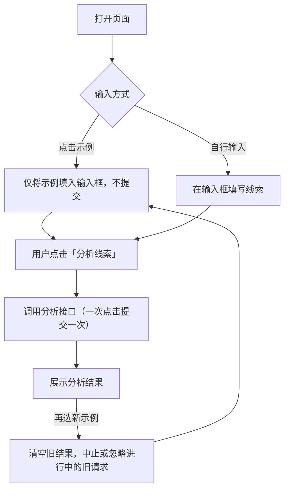

# Product Requirement｜销售线索分析工具｜AI 应用实践

> 状态：草稿。仅包含交付记录中已确认的交互与验证信息；线索判断规则、输出字段与人机边界标记为“待补充”
> 信息来源：某一轮迭代的交付记录（示例按钮与页面说明文案调整）
> 关键假设：分析由页面调用分析接口完成；用户手动触发，不自动提交。

---

## 1. 业务场景摘要

| 项目 | 内容 |
|---|---|
| 产品定位 | 用户输入一条销售线索的内容，点击「分析线索」，页面返回分析结果，辅助销售判断线索 |
| 流程起点 | 用户选择示例，或在输入框中填写线索内容 |
| 流程终点 | 页面展示该次线索的分析结果 |
| 参与者 | 用户（销售或销售负责人）、分析接口 |
| 输入 | 输入框中的线索文本；页面提供 4 个示例案例 |
| 预期结果 | `待补充`：分析结果包含哪些字段（如等级、依据、建议动作、不确定点） |
| 待确认信息 | `待补充`：线索判断标准、是否使用大模型、结果如何被人复核 |

## 2. 交互流程

## 3. 模块与交互规则

| ID | 模块 | 规则 | 输出或状态 | 异常去向 |
|---|---|---|---|---|
| M1 | 示例区 | 4 个示例按钮；点击只把对应案例填入输入框，**不调用分析接口、不自动开始分析** | 输入框内容被替换为示例 | — |
| M2 | 输入框 | 接收示例填入或用户手动输入的线索文本 | 待分析文本 | `待补充`：空输入、超长输入的处理 |
| M3 | 「分析线索」按钮 | 唯一的提交入口；点击一次，提交一次 | 触发分析请求 | `待补充`：接口失败时的提示 |
| M4 | 结果区 | 选择新示例时清空旧结果；旧请求若仍在进行，则中止或忽略，不覆盖新状态 | 当前线索对应的结果 | — |
| M5 | 示例区说明文案 | 文案为「点击示例填入内容，点击「分析线索」后开始分析」，让用户明确“填入”与“分析”是两步 | 页面提示 | — |

## 4. 分析与责任边界

本案例沿用 Workflow / Agent / Human 的分工视角。目前只有“谁触发”是确定的，其余待补充。

| 环节 | 主要执行者 | 判断理由 | 交接条件 |
|---|---|---|---|
| 选择示例、填入输入框 | 页面（固定交互） | 纯前端行为，结果可预期 | 用户确认内容后再提交 |
| 提交分析 | **用户手动触发** | 避免示例一点击就消耗一次分析，也避免用户还没确认内容就开始分析 | 用户点击「分析线索」 |
| 线索分析 | `待补充`（接口 / Agent） | `待补充` | `待补充`：低置信度、信息不足时如何处理 |
| 线索最终判断与跟进 | `待补充` | `待补充` | `待补充`：销售是否必须复核后再行动 |

## 5. 迭代记录（已确认的一轮）

| 要求 | 具体内容 | 处理结果 |
|---|---|---|
| 示例按钮仅填入 | 四个示例按钮只填入输入框，不调用分析接口、不自动分析 | 该行为上一轮已实现，本轮复核确认保持不变。仅「分析线索」按钮手动提交；选择新示例会清空旧结果，并中止或忽略进行中的旧请求 |
| 页面说明文案 | 把示例区说明改为「点击示例填入内容，点击「分析线索」后开始分析」 | 已修改，并在预览页面实际抓取验证，新文案已生效 |

> 这是对一个已有行为的复核加文案修改，所以本轮没有改动提交逻辑。需求里把“只填入、不自动提交”写成明确规则，是为了防止后续迭代改变这个行为。

## 6. 验证测试案例

| ID | 类型 | 前置条件 | 预期结果 | 通过标准 | 验证状态（据交付记录） |
|---|---|---|---|---|---|
| T01 | 示例仅填入 | 点击任一示例 | 内容填入输入框，不发起分析请求 | 未手动点击「分析线索」时无请求 | 行为已在上一轮实现，本轮复核确认；未见独立的浏览器测试记录 |
| T02 | 手动提交 | 输入框有内容，点击「分析线索」 | 提交一次分析 | 一次点击对应一次请求 | `待回填` |
| T03 | 切换示例 | 已有结果或请求进行中，再选新示例 | 清空旧结果，旧请求被中止或忽略 | 旧结果不会覆盖新示例 | 同 T01，复核确认；`待回填`浏览器实测 |
| T04 | 文案 | 打开页面 | 显示新说明文案 | 服务端渲染输出中存在该文案 | 已验证（预览页面实际抓取） |
| T05 | 静态检查与探活 | 运行 lint、类型检查，访问页面 | 全部通过，页面返回 200 | 日志无新增错误 | 已验证（`pnpm lint`、`pnpm ts-check` 通过，页面 200） |

> 验证状态以交付记录为准：已写明实际验证的才标“已验证”，其余保持待回填。

## 7. 已知问题与排查结论

**现象**：控制台出现 hydration 不匹配的警告。

**排查**：警告指向 `<html>` 上被注入的 `data-immersive-translate-page-theme` 属性，来源是预览环境浏览器里的“沉浸式翻译”扩展，在 React hydration 之前改动了 HTML。页面没有会造成服务端与客户端渲染不一致的动态逻辑（如渲染期使用 `typeof window`、`Date.now()`），输入框 `rows` 由固定字符串计算，结果确定。

**结论**：属于浏览器扩展造成的环境噪声，与项目代码无关，无需处理。

> 交付中的一个判断点：看到警告时，先区分“环境噪声”和“代码缺陷”，并给出可核对的依据，而不是直接忽略或盲目改代码。

## 8. 建议的 V1 实施范围

### 先做

- 4 个示例案例，点击仅填入；「分析线索」手动提交，一次点击一次请求
- 切换示例时清空旧结果，并处理进行中的旧请求
- 清楚的页面说明，让用户明白“填入”和“分析”是两步

### 暂不做

- `待补充`

### V1 完成标准

- 示例按钮不触发分析，提交只来自「分析线索」
- 切换示例后，不出现旧结果覆盖新状态的情况
- `待补充`：分析结果的可复核标准

## 9. 待补充清单

1. 原始需求：线索判断的目标、判断标准与输出字段
2. 分析方式：是否使用大模型，输入输出如何约束
3. 人机边界：什么情况必须由销售或负责人复核，低置信度如何处理
4. 异常处理：空输入、超长输入、接口失败、请求超时
5. 在线地址：`待补充`
