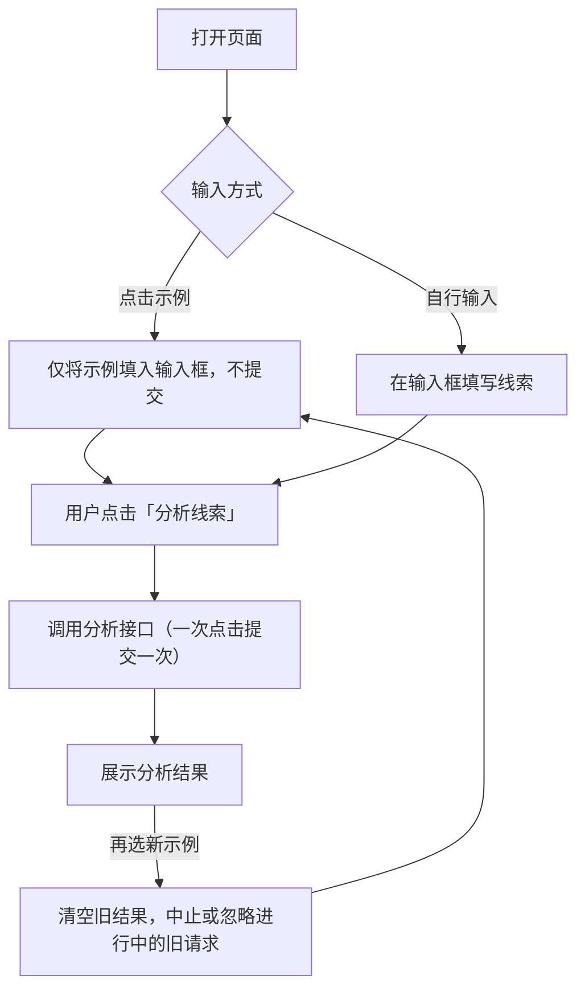

# Product Requirement｜销售线索分析工具｜AI 应用实践

> 状态：草稿。仅包含交付记录中已确认的交互与验证信息；线索判断规则、输出字段与人机边界标记为“待补充”
> 信息来源：某一轮迭代的交付记录（示例按钮与页面说明文案调整）
> 关键假设：分析由页面调用分析接口完成；用户手动触发，不自动提交。

---

## 1. 业务场景摘要

| 项目 | 内容 |
|---|---|
| 产品定位 | 用户输入一条销售线索的内容，点击「分析线索」，页面返回分析结果，辅助销售判断线索 |
| 流程起点 | 用户选择示例，或在输入框中填写线索内容 |
| 流程终点 | 页面展示该次线索的分析结果 |
| 参与者 | 用户（销售或销售负责人）、分析接口 |
| 输入 | 输入框中的线索文本；页面提供 4 个示例案例 |
| 预期结果 | `待补充`：分析结果包含哪些字段（如等级、依据、建议动作、不确定点） |
| 待确认信息 | `待补充`：线索判断标准、是否使用大模型、结果如何被人复核 |

## 2. 交互流程

## 3. 模块与交互规则

| ID | 模块 | 规则 | 输出或状态 | 异常去向 |
|---|---|---|---|---|
| M1 | 示例区 | 4 个示例按钮；点击只把对应案例填入输入框，**不调用分析接口、不自动开始分析** | 输入框内容被替换为示例 | — |
| M2 | 输入框 | 接收示例填入或用户手动输入的线索文本 | 待分析文本 | `待补充`：空输入、超长输入的处理 |
| M3 | 「分析线索」按钮 | 唯一的提交入口；点击一次，提交一次 | 触发分析请求 | `待补充`：接口失败时的提示 |
| M4 | 结果区 | 选择新示例时清空旧结果；旧请求若仍在进行，则中止或忽略，不覆盖新状态 | 当前线索对应的结果 | — |
| M5 | 示例区说明文案 | 文案为「点击示例填入内容，点击「分析线索」后开始分析」，让用户明确“填入”与“分析”是两步 | 页面提示 | — |

## 4. 分析与责任边界

本案例沿用 Workflow / Agent / Human 的分工视角。目前只有“谁触发”是确定的，其余待补充。

| 环节 | 主要执行者 | 判断理由 | 交接条件 |
|---|---|---|---|
| 选择示例、填入输入框 | 页面（固定交互） | 纯前端行为，结果可预期 | 用户确认内容后再提交 |
| 提交分析 | **用户手动触发** | 避免示例一点击就消耗一次分析，也避免用户还没确认内容就开始分析 | 用户点击「分析线索」 |
| 线索分析 | （接口 / Agent） |低置信度、信息不足时如何处理 |
| 线索最终判断与跟进 | 销售是否必须复核后再行动 |

1. 原始需求：线索判断的目标、判断标准与输出字段
2. 分析方式：是否使用大模型，输入输出如何约束
3. 人机边界：什么情况必须由销售或负责人复核，低置信度如何处理
4. 异常处理：空输入、超长输入、接口失败、请求超时

