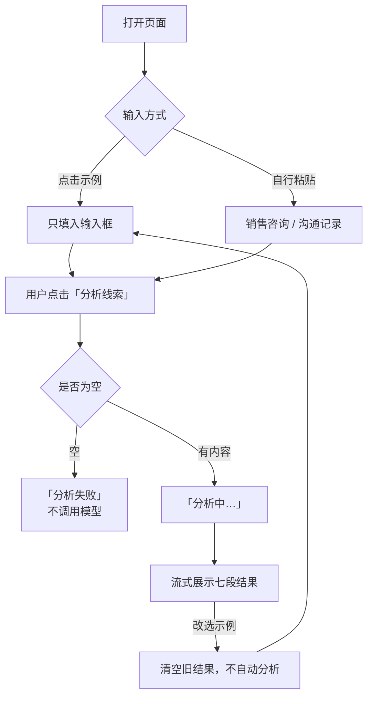

# Case 05｜销售线索 Agent 交付

> **说明**：模拟演示 / 假设练习，不是真实销售流程的上线记录。下文的交互、输出结构和判断边界，来自原型上已核对的行为：[销售线索助手 ↗](https://sales-lead-web.coze.site)。页面标题为「销售线索助手」，标签为「企业内部线索整理」。
>
> 本篇是第二份业务场景练习，不替代 [Case 06](./case-06-return-refund-e2e-delivery.md)。面试与招聘仍先读 Case 06。

## 结论

销售线索助手交付的是可复核的整理：已确认信息与待确认项分开，记录冲突只标记、不选边，下一步和跟进话术停在草稿，正式资格与是否发送仍由人决定。

## 一页摘要

| 项 | 内容 |
| --- | --- |
| 业务问题 | 销售咨询和沟通记录散在对话里。信息齐不齐、记录是否冲突、下一步怎么说，需要先整理清楚再跟人复核。 |
| 交付目标 | 用户粘贴一段记录后，整理出线索信息、待确认项、下一步建议和跟进话术草稿。 |
| 方案形态 | 页面固定交互负责填入、计数和空提交拦截；销售线索判断 Agent 按固定七段输出；人复核第七节，并决定是否跟进或发送。 |
| 交付角色 | 划清页面 / Agent / 人的边界，把输出字段和演示可验证点写成可核对的口径。 |
| 演示可验证点 | 示例只填入；空提交在前端拦截且不调用模型；改选示例会清空旧结果且不自动分析；结果为七段，无等级分、无数字置信度；冲突不任选；不编造效果承诺；话术标明草稿。 |

页面说明：粘贴销售咨询或沟通记录，由销售线索判断 Agent 整理线索信息、待确认项、下一步建议和跟进话术草稿。

## 现状与范围

演示场景是企业内部线索整理。销售拿到一段咨询或沟通记录，先看已经说到哪里、还缺什么、两处记录是否打架，再决定要不要跟。

| 类型 | 内容 |
| --- | --- |
| 做 | 线索摘要；已确认信息及来源；九个需求字段各标「已确认 / 待确认」；信息完整度、目前可判断的匹配信号、待核实事项；下一步建议；跟进话术草稿；把残余风险交给人工 |
| 不做 | A/B/C 等级或数字置信度；正式资格评定；在缺少产品资料和评分规则时自行补一套匹配标准；冲突双方任选其一；编造转化率等效果承诺；自动发送话术；把提交内容记在页面上；接入 CRM 或回写客户系统 |

页面上的两条声明属于本范围：

- 请勿输入真实客户敏感个人信息；页面不记录提交内容
- 跟进话术仅为草稿，不会自动发送；示例用于演示判断逻辑

## 人机边界

原则：价值是把线索整理到人能复核，不是替销售做资格评定或替人发出去。

| 环节 | 执行者 | 边界 |
| --- | --- | --- |
| 选择示例、填入文本、展示 `n / 8000 字`、拦截空提交 | 页面（固定交互） | 点击示例只填入，不提交、不分析。空提交在浏览器内完成，不调用模型 |
| 整理线索 | Agent | 固定七段。冲突只标记、不选边。没有经核实的数据时不编造效果承诺。缺少产品资料或评分规则时，说明尚无评分规则或产品匹配标准 |
| 复核、跟进、发送 | 人 | 第六节只是话术草稿，不会自动发送。第七节把残余风险交人。是否推进、是否对外发送，由人决定 |

## 交互与模块规则

| ID | 模块 | 规则 | 输出或状态 | 异常去向 |
| --- | --- | --- | --- | --- |
| M1 | 示例区 | 4 个示例。点击只把对应内容填入输入框，不调用分析、不自动开始分析。改选示例会清空已有结果，仍不自动分析 | 输入框被替换为该示例 | — |
| M2 | 输入框 | 字段名为「销售咨询 / 沟通记录」。占位符为「在此粘贴客户的咨询内容或销售沟通记录……」。计数器为 `n / 8000 字` | 待分析文本 | 空内容不在本模块拦截，见 M3 |
| M3 | 「分析线索」 | 唯一提交入口。有内容时用户点击后才开始分析；加载文案为「分析中…」 | 进入分析并等待流式结果 | 空提交：前端提示「分析失败」，以及「请先粘贴销售咨询或沟通记录，或点击左侧示例填入。」不调用模型 |
| M4 | 结果区 | 只展示当前这次提交的结果。改选示例时清空旧结果，且不自动分析 | 七段整理结果。演示中结果以流式返回，大约 20–40 秒，此为观察值，不是时限承诺 | — |
| M5 | 示例区说明 | 文案为「点击示例填入内容，点击「分析线索」后开始分析」，把「填入」和「分析」分成两步 | 页面提示 | — |

## 输出字段与验收口径

结果固定为七段。没有 A/B/C 等级，也没有数字置信度。

| 段落 | 内容 |
| --- | --- |
| 一、线索摘要 | 这段记录在说什么 |
| 二、已确认信息与来源 | 已经能从记录里读出的信息，以及它出自哪里 |
| 三、需求与匹配情况 | 九个字段各自标「已确认」或「待确认」：当前痛点、希望改善的业务结果、使用场景、涉及团队/用户规模、现有方案、采购时间、预算、决策参与人、技术/合规约束 |
| 四、线索判断 | 信息完整度、目前可判断的匹配信号、待核实事项。并写明这是初步整理，不是正式资格评定 |
| 五、建议的下一步 | 建议人接下来核实或推进什么 |
| 六、跟进话术草稿 | 可供人修改的草稿，不自动发送 |
| 七、风险与人工判断 | 仍须人判断的残余风险 |

演示可核对的完成定义：

- 空输入点击「分析线索」时，出现「分析失败」和「请先粘贴销售咨询或沟通记录，或点击左侧示例填入。」，且不调用模型
- 点击示例只填入，不自动提交、不自动分析
- 改选示例会清空旧结果，且不自动分析
- 记录冲突被显式标记，不替用户选定一方
- 第六节是跟进话术草稿；页面声明不会自动发送
- 输出保持七段，不含等级分或数字置信度；第四节说明是初步整理，不是正式资格评定
- 材料里没有产品资料或评分规则时，Agent 说明尚无评分规则或产品匹配标准，不另行编造一套

## 四个示例的覆盖意图

四个示例只覆盖判断边界。表内事实是示例原文里的情节，不是本案例测得的业务结果。

| 示例 | 覆盖意图 | 示例中的情节 | 要守住的边界 |
| --- | --- | --- | --- |
| 1 | 需求明确 / 信息齐全，可推进 | 跨境家居电商；约 30 人销售团队；月约 4000 条站内咨询；目前人工分配，口径含品类、国家地区、意向；在用 HubSpot；希望两月内试点；预算上限 10 万且已批；销售总监牵头，IT / 信息安全参与；中英文；尚未提供我方产品资料和评分规则 | 已给出的信息标为已确认，并建议下一步；缺少产品资料和评分规则时，不做正式资格评定 |
| 2 | 信息待补，关键项待确认 | 希望用 AI 提升销售效率，但还不确定做成什么；预算、时间、CRM、决策人、产品资料均未提供 | 未出现的字段标「待确认」，不把空白写成事实 |
| 3 | 记录冲突，必须标记 | 客户说希望保留 HubSpot；销售记录写成 Salesforce | 两处都保留，并标明冲突，不任选一个 CRM |
| 4 | 效果承诺，不编造 | 询问能否保证转化率提高 20%，以及 HubSpot 能否免费接入；没有经核实的数据 | 不把提问写成承诺，不编造效果或免费接入的结论 |

## 风险护栏

| 风险 | 护栏 |
| --- | --- |
| 把整理当成资格评定 | 第四节写明初步整理、非正式资格评定；全文不出现等级分或数字置信度 |
| 缺标准仍给匹配结论 | 未提供产品资料或评分规则时，说明尚无相应标准 |
| 冲突被悄悄选边 | 冲突显式标记，两侧都保留 |
| 编造转化率、免费接入等承诺 | 没有经核实的数据就不写承诺 |
| 话术被当成已经发出 | 第六节标题即为草稿；页面声明不会自动发送 |
| 敏感个人信息进入演示 | 页面要求勿输入真实客户敏感个人信息，并声明不记录提交内容 |

## 诚实边界与待真实业务补齐

本篇只核对了原型上看得见的交互和输出。下列事项要等真实业务补齐后才能写成上线口径：

- 真实的线索评分规则，以及我方产品资料、产品匹配标准
- CRM 接入与回写。示例文本里出现 HubSpot、Salesforce，原型本身没有接入其中任何一个
- 提交内容的日志、留存和合规。原型声明不记录提交内容；真实环境需要另定保留期限、访问权限和脱敏
- 超过 8000 字之后是禁止继续输入、截断，还是仍允许提交。本次演示只核对到计数器 `n / 8000 字`
- 空提交以外的失败态，例如接口失败、超时、流式中断时的提示与是否可重试
- 谁有权复核第七节、谁可以改写并真正发送话术，以及发送前的确认步骤

案例不估算节省金额，也不设灰度阶段。价值与上线节奏见 [Case 06](./case-06-return-refund-e2e-delivery.md)。

## 原型

[在线体验销售线索助手 ↗](https://sales-lead-web.coze.site)
