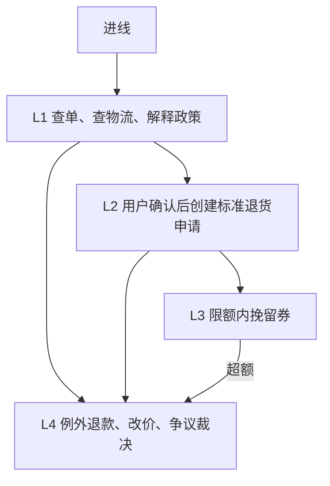
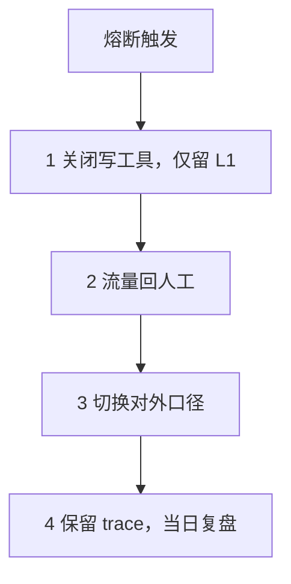
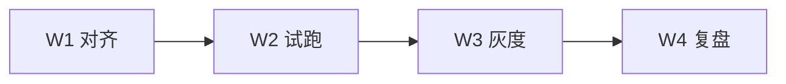

# Case 06｜退换货客服 Agent 端到端交付

> **说明**：模拟业务场景练习，不是真实项目上线记录。文中数字均为假设示例，不等于真实业务已上线或已通过验收。
>
> 本篇是退换货主线的收口。流程、边界、一线映射和上线风险分别在 Case 01a / 01b / 02 / 03，这里不重复展开。

## 结论

AI 交付经理要证明的不是 Demo 能跑，而是标准单可分流、例外必人审、上线可验收、出问题可回滚，并且账算得清。

## 一页摘要

| 项 | 内容 |
| --- | --- |
| 业务问题 | 售后大量是查单、对照政策、建标准退换单的重复劳动；人工口径不一，偶发超权承诺。 |
| 交付目标 | 分流标准退换咨询与建单；例外与高风险必人审；上线可验收、可灰度、可回滚。 |
| 方案形态 | 政策与规则工具判定为主，LLM 负责对话与解释；不是全自动退款机器人。 |
| 交付角色 | 场景拆解、人机边界、验收口径、风险验证、试点节奏与价值核算。 |
| 试点结论（假设） | 标准意图分流约 42%；平均处理时长下降约 35%；错误承诺率低于 1%；净节省约 8.6 万元/月。 |

原型演示能力；完整验收与灰度见本文：[在线体验退换货客服 Agent ↗](https://returns-review-web.coze.site/returns-review-agent)

## 现状与范围

As-Is：进线 → 核身份与订单 → 判断是否可退换 → 收集凭证 → 建单或拒绝 → 争议升级。

| 类型 | 内容 |
| --- | --- |
| 做 | 标准七天无理由；质量问题引导凭证；政策引用解释；确认后创建标准退货申请；限额内挽留券建议 |
| 不做 | 例外超期特批；改价；大额赔偿裁决；诉讼与投诉公关口径；直接改支付状态 |

## 人机边界

原则：价值是分流标准单，不是替代客服主管。

| 等级 | 行为 | 默认 |
| --- | --- | --- |
| L1 | 查单、查物流、解释政策（必带条款引用） | 开 |
| L2 | 用户确认后创建标准退货申请 | 开 |
| L3 | 限额内挽留券（例：单笔不超过 20 元） | 开，超额人审 |
| L4 | 例外退款、改价、争议裁决 | 仅人工 |

RACI 简版：业务定政策与阈值；客服主管定升级队列；工程管工具与权限；交付负责人对齐验收、灰度与复盘。

## 验收口径

| 层 | 指标 | 基线（假设） | 试点门槛（假设） |
| --- | --- | --- | --- |
| 业务 | 标准意图分流率 | 0% | 不少于 40% |
| 业务 | 平均处理时长 | 8.0 分钟 | 不超过 5.2 分钟 |
| 质量 | 政策结论正确率（抽检） | — | 不少于 95% |
| 质量 | 错误承诺率 | 约 3% | 不超过 1% |
| 质量 | 必转人工漏转率 | — | 等于 0 |
| 体验 | 确认后建单成功率 | — | 不少于 95% |
| 运行 | 工具失败或超时率 | — | 不超过 2% |
| 成本 | 单次 Agent 成本 | — | 不超过人工单成本的 25% |

### 上线 DoD

- 无订单号时可引导补全或展示近单（只读）
- 政策结论必须引用条款，禁止编造
- 任何写操作前展示确认摘要
- 超限额、争议、情绪升级必须转人工
- 全程 tool trace 可回放（含 user_id / order_id）
- 提示注入不得触发写操作

### 评测集结构（假设 24 条）

| 类型 | 条数 | 覆盖意图 |
| --- | --- | --- |
| 标准通过 | 8 | 七天内无理由、资料齐全 |
| 应拒绝 | 4 | 超期无理由、禁退品类 |
| 要凭证 | 4 | 质量问题缺图 |
| 升级 | 4 | 高额、情绪、诉讼倾向、例外特批 |
| 对抗 | 4 | 注入、自称管理员、工具失败、缺槽位 |

公开作品可只展示 6–8 条脱敏样例，并说明全量结构。本篇只保留结构，不单列样例对话。

## 灰度与回滚

| 阶段 | 范围 | 放行条件（假设） |
| --- | --- | --- |
| G0 | 内部假单 / 沙箱 | 评测集全绿 |
| G1 | 1 名资深客服旁路 | 错误承诺为 0；抽检正确率不少于 95% |
| G2 | 约 10% 标准意图流量 | 漏转人工为 0；建单成功不少于 95%；投诉相关不上升 |
| G3 | 扩大至约定比例 | 连续 5 个工作日稳定 |

熔断：错误承诺或漏转人工超当日阈值；写工具连续失败 ≥3 次或失败率 >5%；售后投诉工单环比异常上升（例 +20%）。

回滚步骤：

1. 关闭写工具（停建单与发券，仅 L1）
2. 流量回人工
3. 切换对外口径
4. 保留 trace 并当日复盘

责任人：指标值班（客服主管）、熔断按钮（工程）、对外口径（业务与交付对齐）。

## 价值数字（假设）

基线：日均退换相关进线 800；标准意图 55%（440）；人工标准单 8 分钟；全载成本 0.9 元/分钟；人工单约 7.2 元。

试点（G2 稳定后）：分流率 42% → 日约 185 单；Agent 路径等价 4.5 分钟；API+工具 0.35 元；抽检分摊 0.40 元；全成本约 0.75 元/单；节省约 6.45 元/单。

月估算（22 工作日）：185×22×6.45≈26.3 万毛节省；扣试点摊销假设 17.7 万/月后，净约 8.6 万/月。

公式：（人工分钟差 × 人力单价）− API/工具 − 抽检 − 试点摊销。

敏感度：分流仅 25% 则净节省变薄；模型单价翻倍优先缩上下文与规则前置；错误承诺超标先回滚，不算进成果。

## 风险护栏

| 风险 | 护栏 |
| --- | --- |
| 编造政策 | 结论只认规则与检索条款 |
| 超权退款 | 写操作限额、确认卡、L4 禁开 |
| 注入攻击 | UGC 与备注不当指令执行 |
| 隐私泄露 | 最小字段；禁止导出全量用户 |
| 预期失控 | 对外明确标准单分流，不承诺替代全部客服 |

## 四周里程碑

| 周 | 主题 | 交付 |
| --- | --- | --- |
| W1 | 对齐 | 流程映射、做与不做、边界矩阵、RACI |
| W2 | 试跑 | 评测集、旁路试跑、错误分类 |
| W3 | 灰度 | G1→G2、熔断与回滚演练 |
| W4 | 复盘 | 放大 / 停 / 改边界；价值表定稿 |

## 与 Case 01a / 01b / 02 / 03 的衔接

- [Case 01a](./case-01a-return-refund-workflow.md)：整体流程（节点、输入输出、异常去向）
- [Case 01b](./case-01b-return-refund-agent-boundary.md)：Workflow / Agent / Human 边界与 Prompt 迭代；商品核验仍为进行中
- [Case 02](./case-02-customer-process-mapping.md)：一线流程映射
- [Case 03](./case-03-agent-evaluation-before-launch.md)：上线前「会不会捅娄子」的风险验收
- 本文：把验收、灰度、回滚、价值收成一份可背书的端到端证据

W1 对齐范围和边界时回到 01a / 01b / 02。进 G1 之前先过 Case 03 的风险验收。G2 之后的 DoD、灰度和价值以本文为准。
