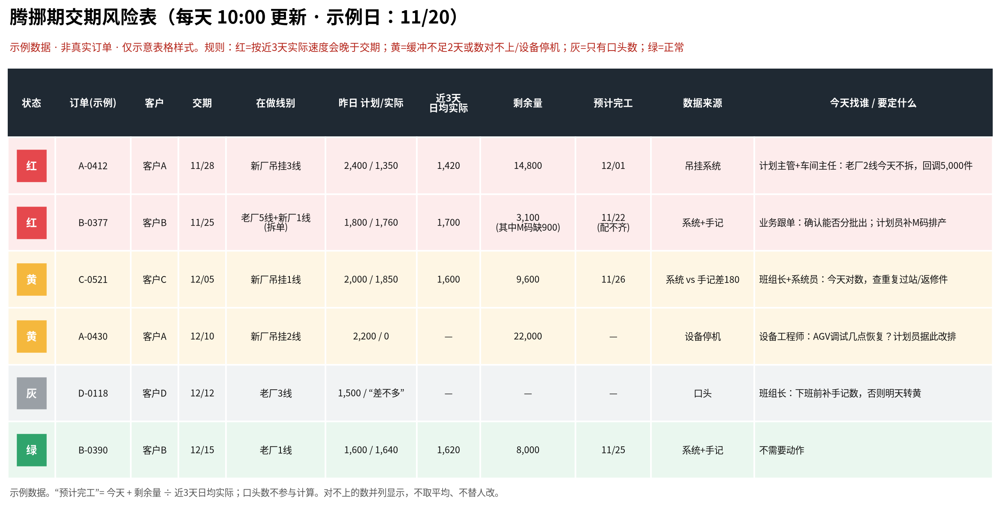

# 申洲针织（安徽）生产计划部：产能腾挪期 AI 落地试点方案
## 新厂接得住之前，老线先别停

## 版本与阅读顺序

在线正文有第一至第九节。下面两份 PDF 都保留，路径不变，覆盖范围不同。原试点稿不是全文，也不包含第九节的订单情节。

| 顺序 | 读什么 | 范围 | 版本 |
| --- | --- | --- | --- |
| 1 | [原试点稿 PDF](./assets/case-07/shenzhou-ai-pilot.pdf) | 第一至第八节，写到「风险、边界和暂不做的事」和当时的来源列表为止 | 2026-11-15 冻结快照，7 页 |
| 2 | 在线[第九节 A-0412](#a-0412)，或[订单场景说明 PDF](./assets/case-07/order-change-scene-v2.pdf) | 只有客户 A 加单这一个虚构情节 | 2026-11-17-v1，1 页 |

先读第一至第八节，再读第九节。两条场景怎么放在一起、建议先试点哪一步，见[专项总纲](./shenzhou-overview.md)。原试点稿 PDF 文末仍印着「来源（详见 research.md）」；本仓库没有这份文件，在线正文以文末列出的链接为准。

> **声明：** 本方案是基于公开资料的推演，没有使用任何内部信息。文中标【事实】的内容来自年报、ESG 报告、政府和媒体报道、公开招聘，来源编号见文末；标【推演】的是按行业常识设想的场景，需要到现场验证。文中角色只用职位称呼，订单和数字凡标「示例」或「假设」的，都不是真实数据。
>
> **AI 落地试点小组（简称「试点小组」）的做法：** 到现场先摸清真实情况，再在真实数据上做出马上能用的小东西，和一线一起改到好用，最后用数字让管理层拍板。先把数做准，再决定哪里值得上系统、上 AI。

---

## 一、结论先说

**管理层以为的问题**【推演】：新厂产能爬得不够快，排产不够「智能」，所以想上 AI 智能排产。

**真正卡住的问题**【推演】：腾挪期间，每张单「今天真实做到哪、按现在的速度能不能赶上交期」，没有一个大家都认的准数。风险也没有人在当天送到能拍板的人面前。系统数、班组长手记、口头报数是三套数，计划员拿着三天前的表在排产，等发现一张单要晚，已经来不及调线了。

**所以第一步不上系统，也不上 AI。** 两周内在真实数据上跑起一张「腾挪期交期风险表」：每天 10 点告诉计划主管哪几单会晚、差多少、今天找谁定什么。同时请管理层定两条规则：新线没接住之前老线不停，每天报数以准数为准。

---

## 二、背景：为什么是现在、为什么是计划部

| 事实 | 来源 |
|---|---|
| 集团要在安徽先建一座自动化程度更高的新成衣工厂，「騰挪置換原工廠的部分產能」，同时「不影響整體產能」 | 【事实】[S2] |
| 截至 2026 年 6 月，新厂房土建已全面竣工，正在安装配套设施和生产设备 | 【事实】[S3] |
| 新项目有全自动吊挂线、AI 视觉质检、AGV（自动搬运小车）、工业互联网平台；一期目标是效率 +40%、能耗 -20% | 【事实】[S17][S20] |
| 安徽基地约 1 万名员工，日产能约 40 万件，2025 年产量 9620 万件 | 【事实】[S16][S17][S22] |
| 2026 年春节后订单「排到了半年後」 | 【事实】[S22] |
| 前四大客户占集团收入 82.6%；2026 年上半年「部分客户之訂單需求波動加劇」 | 【事实】[S5][S3] |
| 员工成本占销售额约 32.0%，集团要靠自动化「減員增效」 | 【事实】[S3] |

**为什么选计划部（PMC，生产计划与物料控制）。** 腾挪期所有的变化，包括新线爬坡、老线拆迁、人员调动、设备调试和拆单，最后都落成一个问题：这张单能不能按时出。这个问题由计划部来回答，而答不准的代价落在客户身上。在客户高度集中的情况下，一次大客户逾期的影响远大于一张单的罚款。【推演】

---

## 三、设身处地：腾挪期可能发生的 11 个阻塞（均为【推演】）

| # | 阻塞（可想象的瞬间） | 谁最痛 | 后果 | 根因 |
|---|---|---|---|---|
| 1 | **新线日产忽高忽低。** 周一 1,800 件，周二因工位不平衡只有 900 件；排产表按标准产能排，三天就过时 | 计划员 | 交期判断失真，红单发现晚 | 排产用的是「应该能做多少」，不是「最近实际做了多少」 |
| 2 | **系统数和手记对不上。** 吊挂系统报 1,850 件，班组长本子上记 1,670 件：返修件重复过站被多计，手工补做的没挂进系统 | 班组长、计划员 | 计划员不知道该信哪个，干脆打电话问 | 两套数的统计口径不同，没人负责每天核对 |
| 3 | **只有口头数。** 晚上问进度，回答是「差不多做完了」，第二天发现还差 3,000 件 | 计划员、业务跟单 | 跟单已经答应了客户的出货日 | 口头数被当准数用 |
| 4 | **熟练工换线后效率掉。** 老厂平车熟手调到新吊挂线，前两周手法、节拍都要重新适应，产量和收入都下降，有人请假，有人想回老线 | 车间主任 | 新线爬坡比计划慢，老线又已经缺人 | 爬坡期的人员安排和计件收入没有一起考虑（工价很敏感，见第八节边界） |
| 5 | **同一款拆两地做，配不齐。** 一张单拆给老厂 5 线和新厂 1 线，装箱时发现 M 码少了 900 件，上衣和裤子数量也对不上 | 计划员、仓库、跟单 | 整单出不了货，要么分批出，要么等 | 拆单只跟总数，不跟尺码和部件配比 |
| 6 | **设备调试停线没人告诉计划部。** AGV 或吊挂调试停了半天，设备工程师知道，计划员第二天看到实际是 0 才知道 | 计划员、设备工程师 | 一天的产能空档没被补排 | 停机信息不进计划 |
| 7 | **AI 质检初期拦截多。** 阈值没调好，后道堆了一批「疑似不良」等人工复判 | 后道检验、品质 | 成品卡在后道，出货数不够 | 人工复判规则和复判时限没有定 |
| 8 | **新线没完成客户审核，单子挪不过去。** 打算把客户 A 的单移到新线，跟单提醒：新车间还没向该客户报备或通过审核 | 业务跟单、计划主管 | 腾挪计划临时作废，老线产能已经拆了 | 腾挪节奏没有对齐客户报备和审核的节点（集团确有客户审核机制，见 [S9]） |
| 9 | **老线拆早了。** 按搬迁计划，老厂 2 线下周拆；但新厂 3 线只达到计划产能的五成 | 生产负责人、计划主管 | 产能空档，出现红单，需要加班或空运 | 没有「新线接住才停老线」的规则 |
| 10 | **料送错厂区。** 面料和辅料仍按老厂收货，新线开线当天等料 | 仓库、计划员 | 新线空转 | 收货地点和仓位切换没有和排产同步 |
| 11 | **管理层要 AI 智能排产，但底数不准。** 新线标准产能还在变，工时库里没有新线数据，在制品数量对不上 | 管理层、IT | 项目做了几个月，排出来的计划没人敢用 | 先上算法、后补数据，顺序反了 |

### 归纳：一个核心真问题

上面 11 条看起来各不相同，但都会落到同一个结果：**到了要做决定的那一天，没有一个各方都认的准数，也没有人把风险当天送到能拍板的人面前。**

- 第 1、2、3 条是数不准；
- 第 4、6、7、10 条是有人知道，但计划部不知道；
- 第 5、8、9 条是规则空白，没人拍板；
- 第 11 条是想用工具绕过这几个问题。

**所以试点不解决「怎么排得更聪明」，先解决「每天看得准、看得早、找得到人」。**

---

## 四、试点小组的组成与分工

| 角色 | 人数 | 职责 | 在哪个阶段投入最多 |
|---|---|---|---|
| 试点负责人 | 1 人 | 对接管理层，定试点范围，推动两项拍板，对试点结果负责 | 第 0 周（定范围）和第 4 周末（拍板、复盘） |
| 现场交付工程师 | 1–2 人 | 在现场摸数据、跟班，做风险表和小工具，每天跟一线一起改 | 第 0–4 周，全程在现场 |
| 数据/AI 工程师 | 1 人（兼职或远程） | 支持数据导出和计算脚本；第 5 周起评估异常汇总、爬坡预测等 AI 用法 | 第 5 周起加重投入 |
| 客户方：计划主管 | 1 人 | 业务对接人，确认风险表是否好用，在早会上用表做决定 | 第 1 周起每天 |
| 客户方：IT/系统负责人 | 1 人 | 开放只读数据权限，评估哪些字段后续并入 MES/ERP | 第 0 周（开权限）和第 5 周起（系统化评估） |

**分工原则：** 试点小组负责摆事实、做工具；交期承诺、老线停不停、人往哪调，由企业里对应的负责人决定。

## 五、现场实施方案

### 第 0 周（3–5 天）：现场摸清，不做任何东西

**原则：** 不提方案、不发需求表，先看、先问、先跟班。每次占用一线时间不超过 20 分钟，挑交接班和午饭后这类不打扰生产的时段。

**问谁、问什么**

| 角色 | 关键问题 |
|---|---|
| 计划主管 | 上一张差点晚的单，是哪天、怎么发现的？如果能早几天知道，您会怎么做？ |
| 计划员 | 您每天几点、从哪几个地方拼出进度？最不信哪个数？为什么？ |
| 车间主任（老厂、新线各一位） | 新线这周实际每天做多少？是什么在拖：人、设备、物料还是品质？ |
| 班组长 | 系统数和您本子上的数一般差多少？差在哪？报数要花您几分钟？ |
| 业务跟单 | 客户追问进度时，您要打几个电话？哪个客户对交期最敏感？ |
| IE（工业工程） | 新线的标准产能是怎么定的？现在实际达到几成？ |
| 设备工程师 | 未来两周有哪些计划内停机？停机通知现在发给谁？ |
| 品质、后道 | AI 质检每天拦截多少？复判要多久？ |
| 仓库 | 新厂区的料从哪天开始直接收货？ |

**看什么数据（只读，不改任何系统）**
- 排产表（多半是 Excel）、吊挂系统日报、班组长手记、交期和出货计划、搬迁和拆线计划、设备停机记录、质检拦截记录。

**跟一天班**
- 跟新线早班，从开线跟到交班报数，亲眼看一个数是怎么从工位走到报表上的。
- 跟计划员一天，记录每次打电话、对数和改表的时间。

**第 0 周的产出（两样，都是一页纸）**
1. **「一个数从哪来」地图：** 每个关键数由谁产生、几点产生、存在哪里、和其他来源差多少。
2. **3 张近期险情单复盘：** 挑过去一个月险些逾期的单，倒推风险哪一天其实已经可见、是哪个环节卡住、最后是谁拍的板。这一步用来验证「真问题」是否成立；如果不成立，就换方向。

### 第 1 周：做出第一个能用的东西——腾挪期交期风险表

*图：风险表样式。示例数据，非真实订单。*

**范围：** 只覆盖未来 4 周要交、且涉及新线、拆单或待拆老线的订单。先做 20–40 张单，不追求全覆盖。

**每行回答四件事：** 现在做到哪；按近 3 天的实际速度，哪天能做完；比交期早还是晚；今天找谁定什么。

**亮灯规则（工具亮灯，人来决定）**

| 灯 | 规则 |
|---|---|
| 红 | 按近 3 天实际日均速度算，会晚于交期；或者配套不齐，整单出不了 |
| 黄 | 缓冲不足 2 天；或者系统数和手记差距超过 3%（阈值为假设，现场再定）；或者所在的线有计划停机 |
| 灰 | 只有口头数，或者数据缺失 |
| 绿 | 正常 |

**数据从哪来、怎么更新**
- **来源：** 吊挂系统日报（导出）、老线班组长手记（拍照或填一个固定格子）、交期表、停机计划。全部是现有的数据，不新增系统。
- **更新：** 每天 9:30 收前一天的数，10:00 发表，计划主管的早会直接用这张表。
- **工具：** 第一周用共享表格加一个小脚本自动算「预计完工」和亮灯。

**每个角色每天多花几分钟（目标）**

| 角色 | 多花时间 | 做什么 |
|---|---|---|
| 班组长 | ≤ 2 分钟 | 对手记数拍一张照，或填一格 |
| 计划员 | 约 15 分钟 | 导出、核对、发表；但会省下原来打电话和拼表的时间 |
| 车间主任、跟单 | 约 3 分钟 | 只看红黄行 |
| 计划主管 | 约 5 分钟 | 在早会上对红单当场做决定 |

**口头数怎么处理：** 显示出来，但标灰，不参与预计完工的计算。当天下班前要换成手记数或系统数，否则第二天自动转黄。目的不是责怪谁，而是让大家看到「这单其实没人知道做到哪」。

**对不上的数怎么处理：** 两个数并列显示，不取平均，也不由工具或试点小组替人改数。由班组长和系统负责人当天花 5 分钟核对，并记下原因，比如重复过站、返修、未挂入系统、手记漏记。原因攒成一张清单，第三周拿来定统一的计数口径。

**第 1 周的验收：** 用真实数据连续跑满 5 个工作日；计划主管至少有一次在早会上根据这张表做了决定。

### 第 2–4 周：和一线一起改到好用

每周五花 30 分钟复盘：哪张红单被提前发现、提前了几天；哪一列没人看就删掉；一线又提了什么。逐步加进下面这些内容，**每次只加一样**：

1. **新线爬坡曲线：** 每条新线每天的实际产量和计划产能对比，看它在几成、趋势往哪走。这是第六节拍板规则的依据。
2. **拆单配套跟踪：** 拆到两地的单，按尺码和部件跟进度，不只看总数，对应阻塞 5。
3. **停机日历：** 设备工程师把计划停机填进一个共用日历，风险表自动把相关订单标黄，对应阻塞 6。
4. **人员面：** 只记每条线的熟练工人数和新人人数，不评价个人，帮车间主任看换线后的效率变化，对应阻塞 4。
5. **后道堆积：** AI 质检待复判的件数和等待时长，对应阻塞 7。
6. **客户审核节点：** 跟单维护「哪条新线已获哪个客户认可」，排产挪单前先查这张表，对应阻塞 8。

### 第 5 周起：再评估系统化和 AI

只把**已经稳定使用 3 周以上、每天都有人看**的字段，提给 IT 评估是否并入 MES（生产执行系统）或 ERP（企业资源计划系统），符合集团「打通 ERP–MES–PLM」的方向【事实】[S9]。

| 可以用 AI 的地方 | 做什么 | 前提条件（不满足就不做） |
|---|---|---|
| 异常原因汇总 | 把班组长用语音或文字报的异常原因自动归类，生成每周的「卡点 Top5」 | 原因清单已在第 2–4 周稳定下来 |
| 爬坡预测 | 预测每条新线在第几周能达到八成产能 | 每条线至少 4 周的每日真实数据，且计数口径已统一 |
| 智能排产 | 排产建议 | 新线标准产能稳定、工时库包含新线、在制品数据准；三者缺一不做 |

**人和工具的边界：** 工具负责亮灯和摆事实；交期承诺、老线停不停、人往哪调，都由人决定。

---

## 六、要管理层拍板的两件事

### 拍板 1：「新线接住，老线才停」
**规则（参数为假设，由管理层定）：** 一条新线要连续 5 个工作日达到计划产能的八成，并且一次合格率不低于对应的老线，对应的老线才能拆或停。要提前停，须由计划主管和生产负责人共同签字。

**不拍板的代价【推演】：** 安徽日产约 40 万件【事实】[S16]。假设腾挪中有 5% 的产能空档一周（按 6 个工作日算），就少做约 12 万件，而这些单早已排满。结果只能是加班、空运，或者对大客户延期。前四大客户占集团收入的 82.6%【事实】[S5]，代价远不止罚款。

### 拍板 2：「每日报数以准数为准」
**规则：** 每条线在每天 9:30 前报前一天的实际数，以系统数或班组长签字的手记数为准；口头数不进入计划；对不上的数当天核对完。

**不拍板的代价：** 风险表会退回成「看起来很准的口头数汇总」，计划部继续凭感觉排产，红单仍然在来不及的时候才暴露。

---

## 七、怎么判断试点成功（指标均为【假设】，第 0 周后按实际基线再定）

| 看什么 | 试点前（第 0 周实测） | 4 周后目标（假设） |
|---|---|---|
| 红单平均提前几天被发现 | 待测 | 交期前 ≥ 5 天 |
| 因信息断档造成的逾期单 | 待测 | 0 |
| 每日 9:30 前按时报数的线占比 | 待测 | ≥ 95% |
| 系统数和手记数差距超 3% 的线数 | 待测 | 逐周下降 |
| 计划员每天打电话、对数的时间 | 待测（跟班实测） | 减少一半 |
| 一线每人每天新增工作时间 | — | ≤ 2–5 分钟 |

最直接的定性标准是：**计划主管在早会上用这张表做决定，而不是先问一圈。**

---

## 八、风险、边界和暂不做的事

**风险**
- 一线把报数当成考核，于是报好看的数。应对：风险表只看单、不看人，第一个月不和任何考核挂钩。
- 现场交付工程师变成「人肉报表员」。应对：第 3 周起把每天的更新交给计划员；试点小组只做改进。
- 系统数据导不出来。应对：先用截图加手填的方式跑通流程，再找 IT 接接口。

**边界**
- 不碰工价和计件规则：阻塞 4 只记录现象，交给人力和生产负责人决定。
- 不评价个人绩效，不替计划主管排产，也不替任何人拍板。
- 不对外传任何客户或订单数据，所有工作都在企业内部环境中完成。

**暂不做**
- 不做新系统，不做全厂覆盖，不做 AI 排产，不做大屏。
- 第 4 周复盘之前，不写长篇需求文档。

---

<!-- ORDER-SCENE:START -->
## 九、订单变化场景

### A-0412

**订单变化：客户 A 加单（虚构示例）**

虚构示例：订单、数字和情节均为演示编造，不代表品牌真实订单，也不表示与申洲或任何品牌存在商业合作。

固定场景 change-add-a0412，版本 2026-11-17-v1，示例日 2026-11-20。假设订单 A-0412 新增 6,000 件，原交期 2026-11-28；面料已到、已裁 70%，新厂吊挂 3 线缝制中。客户希望日期 2026-12-02 是另一个待检验日期，不是承诺。

原剩余 14,800 件、近三日日均 1,420 件；完工按示例日加向上取整的自然日算。原单预计 2026-12-01 完工；加单后仅在本线预计 2026-12-05 完工，比客户希望日 2026-12-02 晚 3 天。线别借用是演示假设，不能当作真实排产能力。

- 全接，承诺 11/28：只在本线做完是 12/05。要守住这个日期，需借 6,000 件缓冲。
- 部分接：3,000 件仍按 11/28，其余 3,000 件到 12/05：一半向下取整，另一半顺延 7 天（假设）。为守住前一个日期，要借 3,000 件。
- 换交期到 12/05：承诺改到本线做完的那天（不早于客户提出的日期）。不向其他线借产量。本线完工 12/05。

其他订单原有的停机、缺码、对数差及未知应保留，不能为了方案结局抹除。已投入不等于损失；以上只是固定规则试算，接受与否由人决定。

公开背景：迅销截至 2026-08-31 的[生产伙伴名单第 3 页第 231 项](https://www.fastretailing.com/jp/sustainability/labor/pdf/FRGarmentProcessingFtyList.pdf)列有 Shenzhou Knitting (Anhui) Co., Ltd.；名单含直接及间接合作工厂，不能证明本示例订单或特定品牌关系。

[返回在线体验](https://fionahong-lab.github.io/ai-agent-delivery-casebook/?scene=change-add-a0412) · [下载订单场景说明 PDF](./assets/case-07/order-change-scene-v2.pdf)

公开资料推演，非真实项目。
<!-- ORDER-SCENE:END -->

---

## 来源

本仓库没有单独的 research.md。下面只保留正文用到、且链接写在本文件中的公开来源。编号不连续；没有出现的编号，本仓库里没有对应条目，这里不补写。2026-11-15 的原试点稿 PDF 文末仍保留「来源（详见 research.md）」字样，以这一节为准。
- [S2] 申洲国际 2025 年中期报告：https://www.hkexnews.hk/listedco/listconews/sehk/2025/0929/2025092900839_c.pdf
- [S3] 申洲国际 2026 年中期业绩公告：https://www.hkexnews.hk/listedco/listconews/sehk/2026/0825/2026082500357_c.pdf
- [S5] 东吴证券 2025 年业绩点评（客户占比）：https://www.nxny.com/report/view_6251301.html
- [S9] 申洲国际 2025 年度 ESG 报告：https://www.hkexnews.hk/listedco/listconews/sehk/2026/0423/2026042300679_c.pdf
- [S16] 安庆市工商联报道：http://www.aqgsl.org.cn/html/2025/gongzuodongtai_1117/5428.html
- [S17] 安庆新闻网《申洲安徽智能制造项目开工》：http://www.aqnews.com.cn/2025/04/10/99773302.html
- [S20] 安徽日报《望江纺织服装产业集群向优而进》：http://ah.people.com.cn/BIG5/n2/2026/1105/c358428-41742264.html
- [S22] 望江发布《申洲针织开足马力》：https://info.texnet.com.cn/detail-1068256.html

